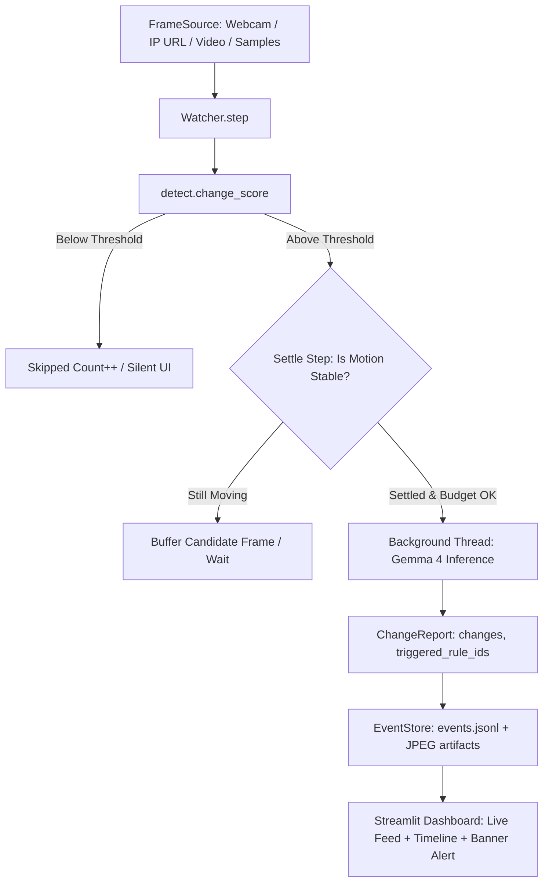

# What Changed? — Open-Source Continuous Visual Change Watcher

> **A camera-watching tool that stays silent until something changes, then uses Gemma 4 to explain what changed, logs it on a timeline, and fires alerts for user-written rules.**

[](LICENSE)
[](https://www.python.org/)
[-purple.svg)](https://ai.google.dev/gemma)
[-orange.svg)](https://ollama.com/)

```
+-------------------------------------------------------------------------------------------------+
| 🚨 RULE ALERT: notify me if the door is opened                                                  |
+-------------------------------------------------------------------------------------------------+
| [Frames Evaluated: 142]  [Frames Skipped: 138]  [% Saved (No AI): 97.2%]  [Gemma Calls: 4]      |
+-------------------------------------------------------------------------------------------------+
| ⏰ 12:08:54  •  Ollama (gemma4:e4b)  •  Diff: 24.3%  •  Latency: 1,420 ms                       |
|   BEFORE [img]  |  AFTER [img]                                                                  |
|   - Water bottle removed from table                                                             |
|   - Office door swung open (Triggered: "notify me if the door is opened")                       |
+-------------------------------------------------------------------------------------------------+
```

---

## 1. Problem
Traditional security cameras and video surveillance pipelines record gigabytes of motionless footage. Querying an AI vision-language model on every single frame at 30 fps is impractical, astronomically expensive, and exhausts rate limits or CPU/GPU compute within minutes. Conversely, naive motion detectors merely detect raw pixel blips, sounding false alarms whenever clouds pass, lights flicker, or shadows shift.

## 2. How It Works
"What Changed?" introduces an intelligent, two-stage architectural pipeline:



1. **Continuous Capture:** Grabs frames from webcams, phone IP cameras, video files, or image directories.
2. **Cheap Pixel Diff (OpenCV):** Normalizes illumination, applies Gaussian filtering, and measures pixel delta. If below threshold (e.g., 2.0%), the frame is dropped with zero model calls.
3. **Motion Settle Step:** If movement is detected, the engine waits until motion finishes across sequential frames so the model inspects the finalized state rather than a hand mid-air.
4. **Budget Guard:** Caps model calls per minute to prevent compute bottlenecks.
5. **Gemma 4 Analysis:** Explains the physical differences, checks user-defined rules, logs before/after snapshots, and fires visual alerts.

---

## 3. How the AI Contributes
Gemma 4 performs the semantic reasoning that pixel algorithms cannot:
- **Discerning Intentionality:** Understands whether a change is meaningful (e.g. an object placed, a door unlatched, a laptop removed) vs environmental artifacts (reflections, shadows, headlights).
- **Object Identification:** Automatically names items ("blue thermos", "MacBook", "backpack").
- **Natural Language Rules Engine:** Judges arbitrary, user-written instructions (e.g. *"alert me if someone leaves a bag behind"*) directly against visual before-and-after observations.
- **Privacy-Preserving Local Inference:** By running open-weight Gemma 4 locally via Ollama, video data never leaves your laptop.

---

## 4. Why Open-Weight Matters Here
1. **Total Physical Privacy:** Surveillance footage from bedrooms, offices, or labs never traverses third-party servers.
2. **True Offline Operation:** Operates without an active internet connection—ideal for remote sites, field deployments, or network outages.
3. **Zero Marginal Cost:** Continuously monitor video feeds 24/7 without per-token API charges.
4. **Model Freedom:** Swap between `gemma4:e4b` for balanced speed or `gemma4:e2b` on low-power laptops.

---

## 5. Quickstart (Local Ollama — Default)

### Prerequisites
- macOS / Linux / Windows
- Python 3.10 to 3.12
- [Ollama](https://ollama.com/) installed

### Setup
```bash
# 1. Start Ollama and pull Gemma 4
ollama serve
ollama pull gemma4:e4b

# 2. Clone repository & install dependencies
git clone https://github.com/your-username/WhatChanged.git
cd WhatChanged
python3.12 -m venv venv
source venv/bin/activate
pip install -r requirements.txt

# 3. Launch Streamlit UI
streamlit run app.py
```
Open [http://localhost:8501](http://localhost:8501) in your browser, verify your camera index (default `0`), and click **▶️ Start**.

---

## 6. Quickstart (Google Gemini API — Hosted Fallback)

If running on a laptop without local GPU acceleration, use Google AI Studio:

```bash
# Copy environment template
cp .env.example .env

# Set your Gemini API key in .env or via shell:
export GEMINI_API_KEY="your-api-key-here"
export WC_BACKEND="gemini"
export GEMINI_MODEL="gemma-4-31b-it"

streamlit run app.py
```

---

## 7. Using a Phone as a Wireless Camera
1. Install an IP Webcam app (e.g., **IP Webcam** for Android or **Live-Reporter** for iOS).
2. Start server in the mobile app (displays `http://192.168.1.XX:8080/video`).
3. In the What Changed? sidebar, enter the URL as the **Frame Source** and click **Start**.

---

## 8. Configuration Reference

| Environment Variable | Streamlit Slider / Control | Default | Description |
|---|---|---|---|
| `WC_BACKEND` | Inference Backend | `ollama` | Backend provider (`ollama`, `gemini`, `fake`). |
| `OLLAMA_MODEL` | Ollama Model | `gemma4:e4b` | Ollama model tag (`gemma4:e4b` or `gemma4:e2b`). |
| `OLLAMA_HOST` | Ollama Host | `http://localhost:11434` | Ollama HTTP endpoint. |
| `GEMINI_API_KEY` | Gemini API Key | `""` | Google AI Studio API key. |
| `GEMINI_MODEL` | Gemini Model | `gemma-4-31b-it` | Remote Gemini model identifier. |
| `WC_INTERVAL` | Check Interval (s) | `5.0` | Seconds between frame evaluation ticks. |
| `WC_SENSITIVITY` | Sensitivity Threshold (%) | `2.0` | Pixel change threshold required to trigger settle check. |
| `WC_MAX_CALLS_PER_MIN` | Budget Guard | `6` | Maximum model inferences allowed per 60-second window. |
| `WC_IMAGE_MODE` | Image Mode | `side_by_side` | Vision input format: `side_by_side` (stitched) or `two_images`. |

---

## 9. Tests & Automated Replay

Run the complete offline test suite:
```bash
pytest -q
```

Run headless replay mode on sample image sets without launching a browser:
```bash
python -m whatchanged.cli --source samples/ --backend fake --interval 0.5 --max-ticks 10
```

---

## 10. Known Limitations
- **Fixed Camera Position:** Expects a static camera view; moving or panning cameras will continuously register change.
- **Lighting Extremes:** Rapid strobe lights or total darkness may degrade pixel normalization.
- **Microscopic Objects:** Objects occupying less than ~1% of visual area may be filtered by the cheap change threshold.
- **CPU Inference Speed:** On laptops running Ollama without GPU/Apple Silicon acceleration, Gemma 4 inference may take 5–15 seconds per call.

---

## 11. Roadmap
- [ ] Interactive Region-of-Interest (ROI) canvas bounding box selector in the UI.
- [ ] Push notifications via Telegram / Webhooks on triggered rules.
- [ ] Multi-camera concurrent switching.
- [ ] Session recap synthesis ("Summarize everything that happened while I was away").

---

## 12. Disclosures & Licensing

### AI Assistance Disclosure
This project was developed for the C³ × Hacktoberfest Hack Day using AI pair-programming tooling. Architecture, code implementations, tests, and documentation were written during the hackathon coding window.

### Model Terms & Weights
Gemma models are subject to the [Gemma Terms of Use](https://ai.google.dev/gemma/terms).

### Software License
This project is open-source under the [MIT License](LICENSE).

### Acknowledgments
- **Google DeepMind & Google Cloud** for the Gemma 4 open-weight model family.
- **C³ Hackstorm / Hack Day Pune / Cloud Computing Club** for hosting the event.
