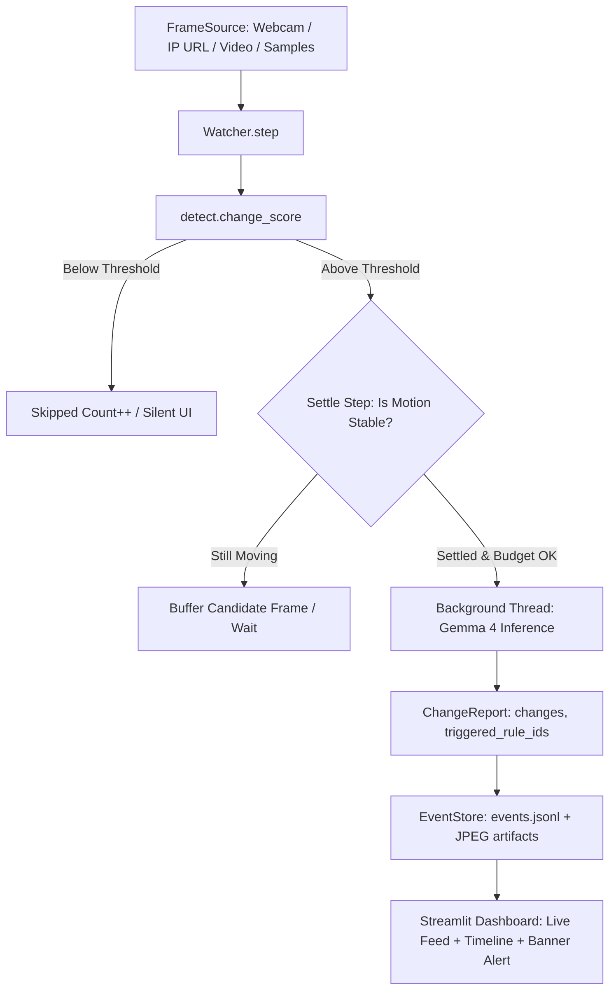

# What Changed? — Open-Source Visual Change Watcher

> **A camera-watching tool that stays silent until something changes, then uses open-weight Gemma 4 to explain *what* changed, log it on a timeline, and fire alerts for user-written rules.**
>
> Built for **C³ × Hacktoberfest Hack Day** — *Best Open-Source AI Project + Best Use of Gemma 4*.

[](LICENSE)
[](https://www.python.org/)
[-purple.svg)](https://ai.google.dev/gemma)
[-orange.svg)](https://ollama.com/)
[](https://streamlit.io/)

```
+-------------------------------------------------------------------------------------------------+
| 🚨 RULE ALERT: notify me if the door is opened                                                  |
+-------------------------------------------------------------------------------------------------+
| [Frames Evaluated: 142]  [Frames Skipped: 138]  [% Saved (No AI): 97.2%]  [Gemma Calls: 4]      |
+-------------------------------------------------------------------------------------------------+
| ⏰ 12:08:54  •  Ollama (gemma4:e2b)  •  Diff: 24.3%  •  Latency: 1,420 ms                       |
|   BEFORE [img]  |  AFTER [img]                                                                  |
|   - Water bottle removed from table                                                             |
|   - Office door swung open (Triggered: "notify me if the door is opened")                       |
+-------------------------------------------------------------------------------------------------+
```

---

## Table of Contents

- [Features](#features)
- [Problem](#1-problem)
- [How It Works](#2-how-it-works)
- [How the AI Contributes](#3-how-the-ai-contributes)
- [Why Open-Weight Matters Here](#4-why-open-weight-matters-here)
- [Project Structure](#project-structure)
- [Prerequisites](#prerequisites)
- [Setup — Run on Your Device](#setup--run-on-your-device)
  - [Option A: Hosted backend (Gemini API, easiest)](#option-a-hosted-backend-gemini-api--easiest--default)
  - [Option B: Local backend (Ollama, private/offline)](#option-b-local-backend-ollama--privateoffline)
  - [Option C: Zero-setup replay (no camera, no key)](#option-c-zero-setup-replay-no-camera-no-key)
- [Using a Phone as a Wireless Camera](#5-using-a-phone-as-a-wireless-camera)
- [Configuration Reference](#6-configuration-reference)
- [Tests & Headless Replay](#7-tests--headless-replay)
- [Troubleshooting](#troubleshooting)
- [Demo Script](#demo-script)
- [Known Limitations](#8-known-limitations)
- [Roadmap](#9-roadmap)
- [Disclosures & Licensing](#10-disclosures--licensing)

---

## Features

- **Continuous watching, silent by default** — evaluates every frame, calls the model only when the scene meaningfully changed.
- **Cheap pixel gate (OpenCV)** — lighting-robust diff with brightness normalization, Gaussian blur, and optional ROI, so 90%+ frames cost zero AI calls.
- **Settle step** — waits until motion stops before asking the model, so Gemma sees the final state, not a hand mid-air.
- **Budget guard** — caps model calls per minute to survive free-tier quotas and slow CPUs.
- **Natural-language rules** — e.g. `notify me if the door is opened`; Gemma judges each change against every rule.
- **Two first-class backends** — hosted Gemma 4 via Gemini API *and* on-device Gemma 4 via Ollama (fully offline).
- **Timeline + alerts** — before/after snapshots, diff %, latency, backend name, red alert banner, Markdown export.
- **Replay anywhere** — `samples/` image-folder source + `fake` backend means the demo works with no camera and no network.
- **Headless CLI** — `python -m whatchanged.cli` for testing, scripting, and CI.

---

## 1. Problem

Traditional cameras record gigabytes of motionless footage. Asking a vision-language model about **every frame** at 30 fps is slow, expensive, and burns through rate limits or CPU/GPU in minutes. Naive motion detectors have the opposite flaw: they fire on any pixel blip — clouds, flickering lights, shifting shadows.

**What Changed?** puts a cheap classical-vision gate in front of an open-weight VLM: pixels decide ***when*** to think, Gemma 4 explains ***what*** happened.

## 2. How It Works



1. **Capture** — grab a frame from webcam (`0`), phone IP stream, video file, or image folder.
2. **Cheap diff** — downscale → grayscale → blur → normalize brightness → `absdiff` → % pixels changed. Below threshold (default 2.0%) → drop silently.
3. **Settle** — first over-threshold frame becomes a *candidate*; only when the next frame is stable vs. the candidate does the pipeline proceed.
4. **Budget check** — if calls in the last 60 s ≥ `WC_MAX_CALLS_PER_MIN`, defer.
5. **Ask Gemma 4** — in a background thread (UI never freezes): send BEFORE + AFTER (stitched side-by-side by default) + numbered rules → strict JSON `{changes, triggered_rule_ids}`.
6. **Log & alert** — persist event (JSONL + JPEGs), update timeline, fire the red banner if any rule triggered, set the candidate as the new reference.

## 3. How the AI Contributes

Gemma 4 does the semantic reasoning pixels cannot:

- **Meaning vs. noise** — distinguishes a placed/removed/moved object, an opened door/drawer, a person entering/leaving from reflections, shadows, compression artifacts, or light toggles.
- **Object naming** — identifies items in plain words ("blue thermos", "MacBook", "backpack").
- **Natural-language rules engine** — judges arbitrary user rules ("alert me if a bag is left behind") against the visual diff with zero training or fine-tuning.
- **Your choice of runtime** — the *same open-weight model family* runs hosted (`gemma-4-26b-a4b-it` / `gemma-4-31b-it` via Gemini API) or fully on-device (`gemma4:e2b` via Ollama, no frame ever leaves the machine).

The code decides *when* to ask and *what to do* with the answer (settle, budget guard, robust JSON parsing with retry, timeline storage).

## 4. Why Open-Weight Matters Here

1. **Privacy** — local Ollama mode: bedroom/office/lab footage never traverses third-party servers.
2. **Offline** — works with Wi-Fi unplugged; ideal for field sites and flaky venue networks.
3. **Zero marginal cost** — monitor 24/7 with no per-token bill.
4. **Swappable** — switch `gemma4:e2b` ↔ `gemma4:e4b` ↔ hosted `gemma-4-31b-it` without changing app code.

---

## Project Structure

```
WhatChanged/
├── app.py                    # Streamlit dashboard (thin UI, no business logic)
├── whatchanged/
│   ├── config.py             # Settings dataclass + .env loading
│   ├── sources.py            # Webcam / URL / video-file / image-folder sources
│   ├── detect.py             # Lighting-robust change_score() + ROI
│   ├── imaging.py            # JPEG resize/encode, side-by-side stitch
│   ├── prompts.py            # BEFORE/AFTER + rules prompt template
│   ├── report.py             # ChangeReport dataclass + fence-tolerant JSON parse
│   ├── engine.py             # Watcher loop: settle, budget guard, async inference
│   ├── store.py              # JSONL event log + image files + Markdown export
│   ├── cache.py              # Offline response cache for samples/ replay
│   ├── cli.py                # Headless runner: --source --backend --interval
│   └── backends/
│       ├── base.py           # Backend protocol (describe_change + name)
│       ├── ollama_backend.py # Local Gemma 4 via Ollama
│       └── gemini_backend.py # Hosted Gemma 4 via google-genai (429 backoff)
├── samples/                  # People-free demo frames (01_empty_desk … 05_bottle_removed)
├── tests/                    # pytest suite (detect, report, engine, sources)
├── scripts/spike.py          # Backend integration spike (two_images vs side_by_side)
├── DEMO.md                   # 90-second live demo script + fallback
├── NOTES.md                  # Engineering decisions & human-verification list
├── plan.md                   # Hackathon build plan (phases 1–9)
├── requirements.txt          # Pinned dependencies
├── .env.example              # Copy to .env — never commit .env
└── LICENSE                   # MIT
```

Data flow: `FrameSource → Watcher.step() → detect.change_score → (settle + budget) → Backend (thread) → ChangeReport → store.append_event → UI timeline + alert`.

---

## Prerequisites

| Requirement | Version / Notes |
|---|---|
| OS | macOS, Linux, or Windows 10+ |
| Python | **3.10+** (3.12 recommended; repo tested on 3.12) |
| pip | latest (`python3 -m pip install --upgrade pip`) |
| Webcam (optional) | any built-in/USB camera; or skip and use `samples/` replay |
| Ollama (Option B only) | [ollama.com](https://ollama.com) — for local offline inference |
| Gemini API key (Option A only) | free key from [Google AI Studio](https://aistudio.google.com/) |
| Git | to clone the repo |

Check yours:

```bash
python3 --version   # need 3.10+
pip --version
git --version
```

---

## Setup — Run on Your Device

### 0. Clone and install (all options)

```bash
# 1. Clone
git clone https://github.com/Abhi-0703/WhatChanged.git
cd WhatChanged

# 2. Create + activate a virtual environment
python3 -m venv venv
source venv/bin/activate          # macOS / Linux
# venv\Scripts\activate           # Windows (PowerShell)

# 3. Upgrade pip + install dependencies
pip install --upgrade pip
pip install -r requirements.txt

# 4. (Optional) copy env template — only needed if you want to
#    persist settings instead of typing them in the sidebar
cp .env.example .env
```

> Never commit `.env` — it is gitignored. Only `.env.example` is tracked.

Verify the install:

```bash
pytest -q        # should print: 23 passed
```

### Option A: Hosted backend (Gemini API — easiest / default)

No model download. Good for first run.

```bash
# 1. Put your key in the environment (or paste it in the sidebar later)
export GEMINI_API_KEY="your-google-ai-studio-key"   # macOS/Linux
# setx GEMINI_API_KEY "your-key"                    # Windows (new terminal after)

# 2. Launch
streamlit run app.py
```

Then in the browser (`http://localhost:8501`):

1. **Frame Source** = `samples/` (no camera needed) or `0` (webcam).
2. **Inference Backend** = `Gemini API (Hosted Gemma 4)`.
3. Paste key + model ID (`gemma-4-26b-a4b-it`) if not exported.
4. Click **▶️ Start**.

### Option B: Local backend (Ollama — private/offline)

Same open-weight Gemma 4, fully on-device. No frame leaves your laptop.

```bash
# 1. Install + start Ollama
# macOS:
brew install ollama && brew services start ollama
# Linux: curl -fsSL https://ollama.com/install.sh | sh && ollama serve
# Windows: download from https://ollama.com/download

# 2. Pull the lightweight model (~2 GB; use e4b on fast machines)
ollama pull gemma4:e2b

# 3. Launch with local backend
export WC_BACKEND="ollama"      # or set Backend radio in the sidebar
streamlit run app.py
```

Select **Local Ollama (On-Device Gemma 4)** in the sidebar → **▶️ Start**. Now unplug Wi-Fi — it keeps working.

### Option C: Zero-setup replay (no camera, no key)

```bash
streamlit run app.py
# Sidebar: Frame Source = samples/ | Backend = Fake Backend (Offline Simulation) | Start
```

Or fully headless (no browser):

```bash
python -m whatchanged.cli --source samples/ --backend fake --interval 0.5 --max-ticks 10
python -m whatchanged.cli --source samples/ --backend gemini --interval 1 --rule "notify me if the door is opened"
```

---

## 5. Using a Phone as a Wireless Camera

1. Install **IP Webcam** (Android) or **Live-Reporter / IP Camera** (iOS) on your phone.
2. Connect phone + laptop to the **same Wi-Fi**, start the server in the app — it shows a URL like `http://192.168.1.23:8080/video`.
3. In the app sidebar set **Frame Source** to that URL → **▶️ Start**.
4. If the venue Wi-Fi isolates clients, use USB tethering / phone hotspot instead.

---

## 6. Configuration Reference

| Env var | Sidebar control | Default | Description |
|---|---|---|---|
| `WC_BACKEND` | Inference Backend | `gemini` | `gemini` (hosted) or `ollama` (local). `fake` only via CLI/sidebar demo. |
| `GEMINI_API_KEY` | Gemini API Key | `""` | Google AI Studio key. Never commit. |
| `GEMINI_MODEL` | Gemma 4 Model ID | `gemma-4-26b-a4b-it` | Hosted ID (`gemma-4-26b-a4b-it` or `gemma-4-31b-it`; list via SDK if rejected). |
| `OLLAMA_MODEL` | Ollama Model | `gemma4:e2b` | Local tag (`gemma4:e2b` fast, `gemma4:e4b` larger). |
| `OLLAMA_HOST` | Ollama Host | `http://localhost:11434` | Ollama HTTP endpoint. |
| `WC_INTERVAL` | Check Interval (s) | `5.0` | Seconds between frame ticks. |
| `WC_SENSITIVITY` | Sensitivity (%) | `2.0` | Pixel-change % to trigger settle check (0.5–10). |
| `WC_MAX_CALLS_PER_MIN` | Budget Guard | `4` | Max Gemma calls per 60-s window. |
| `WC_IMAGE_MODE` | Image Mode | `side_by_side` | `side_by_side` (one stitched image, most compatible) or `two_images`. |
| `WC_MAX_SIDE` | — (env only) | `768` | Max image side sent to model (512 if slow). |
| `WC_JPEG_QUALITY` | — (env only) | `85` | JPEG quality for model payloads. |
| `WC_USE_CACHE` | — (env only) | `true` | Offline response cache for `samples/` replay. |

### Rate-limit handling (HTTP 429)

Near free-tier quotas the Gemini backend catches `429 / RESOURCE_EXHAUSTED`, retries once with backoff, then shows **`RATE LIMITED (SLOWING DOWN)`** and pauses new calls ~15 s so the live feed keeps running while quota recovers. Lower `WC_MAX_CALLS_PER_MIN` if you hit this often.

---

## 7. Tests & Headless Replay

```bash
source venv/bin/activate
pytest -q
# 23 passed

# Headless replay on bundled samples (no camera, no browser)
python -m whatchanged.cli --source samples/ --backend fake --interval 0.5 --max-ticks 10

# Export a Markdown timeline on exit
python -m whatchanged.cli --source samples/ --backend fake --export /tmp/timeline.md
```

Test coverage: `test_detect.py` (identical / brightness-shift / noise / rectangle / ROI), `test_report.py` (fences, prose, garbage, bad rule IDs), `test_engine.py` (static → 0 calls, one change → 1 event, settle, budget defer, exception safety, rule mapping), `test_sources.py` (folder order/loop, bad-spec error).

---

## Troubleshooting

| Symptom | Fix |
|---|---|
| Webcam black / `not authorized to capture video` (macOS) | System Settings → Privacy & Security → Camera → allow Terminal / browser. Or use `samples/` or phone URL. |
| Camera busy (Zoom/Meet open) | Quit the other app, try index `1`, or switch source to `samples/`. |
| `Ollama not running` warning | `ollama serve` (or `brew services start ollama`), then `ollama pull gemma4:e2b`. |
| Ollama slow (>30 s/call) | Use `gemma4:e2b`, set `WC_MAX_SIDE=512`, raise interval to 8–10 s. Inference runs in a thread so the UI stays live. |
| `Missing GEMINI_API_KEY` | Export it or paste in sidebar; get one free at aistudio.google.com. |
| `Gemini 404 / model not found` | Model IDs rotate — list with the SDK and pick the current Gemma 4 ID into `GEMINI_MODEL`. |
| `RATE LIMITED (SLOWING DOWN)` | Free-tier quota — wait ~1 min, lower Budget Guard to 2–3/min. |
| `streamlit: command not found` | You forgot `source venv/bin/activate`; then `pip install -r requirements.txt`. |
| `cv2` import fails on Apple Silicon | Use Python 3.12 from Homebrew (`brew install python@3.12`), fresh venv, reinstall. |
| Port 8501 in use | `streamlit run app.py --server.port 8502`. |

Secret hygiene: `git ls-files | grep -E "\.env$"` must print nothing, and no `AIza…` key may appear in `git log -p`. Keys live only in `.env` (gitignored) or the sidebar field.

---

## Demo Script

Full 90-second script with fallback: see **[DEMO.md](DEMO.md)**.

1. "Normal cameras record everything. This one only thinks when something changes." → point at **% Saved (No AI)**.
2. Add/remove an object → timeline logs before/after + Gemma's sentence.
3. Type a rule live ("alert me if a bag is left here") → trigger it → red banner fires.
4. Disconnect Wi-Fi → trigger another change → still works (local Gemma 4).
5. Close: "The cheap check decides *when*. Gemma 4 explains *what*. Open-weight, so it's private by design."

## 8. Known Limitations

- **Fixed camera only** — panning/moving cameras register constant change.
- **Lighting extremes** — strobes or total darkness defeat brightness normalization.
- **Tiny objects** — items under ~1% of frame area may stay under threshold.
- **CPU latency** — local Gemma 4 can take 5–15 s/call without GPU/Neural Engine; the UI stays responsive via background threads.
- **No tracking/identity** — by design: no object tracking, face recognition, recording, accounts, or cloud storage (see `plan.md` out-of-scope).

## 9. Roadmap

- [ ] Click-to-draw Region-of-Interest (ROI) in the UI
- [ ] Telegram / webhook push on triggered rules (+ audible beep)
- [ ] Multi-camera concurrent watching
- [ ] "Summarize this session" — Gemma recap of the event log
- [ ] GIF snapshot export for the README demo

---

## 10. Disclosures & Licensing

### Built with AI Assistance

Developed during the C³ × Hacktoberfest Hack Day with AI pair-programming. Architecture, code, tests, and docs were written in the event coding window; every teammate can explain every module in the demo.

### Model Terms & Weights

Gemma model weights are subject to the [Gemma Terms of Use](https://ai.google.dev/gemma/terms). Code license below covers code only.

### Software License

MIT — see [LICENSE](LICENSE). Copyright (c) 2026 What Changed Team (C³ × Hacktoberfest Hack Day).

### Acknowledgments

- **Google DeepMind & Google AI** — Gemma 4 open-weight family + Gemini API.
- **Ollama** — local inference runtime.
- **C³ Hackstorm / Hack Day Pune / Cloud Computing Club + MLH** — hosting, mentoring, venue.
- **Streamlit, OpenCV, Pillow, NumPy** — open-source building blocks.

---

*Camera quiet until it matters. Pixels decide when. Gemma explains what.*
